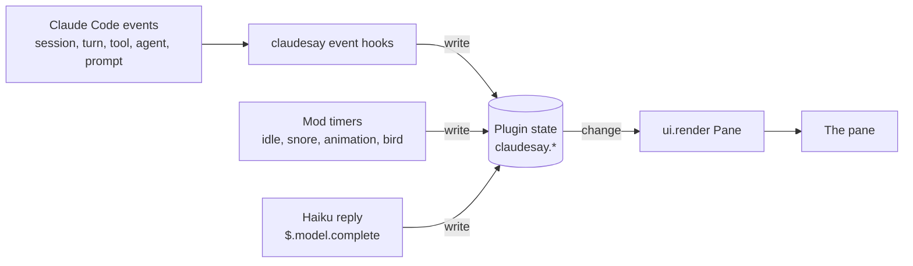
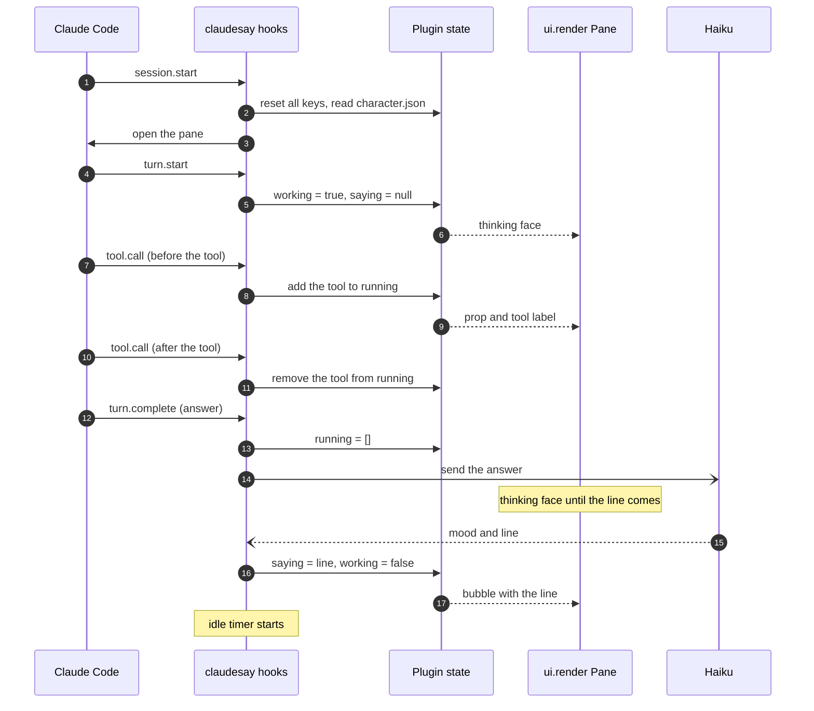
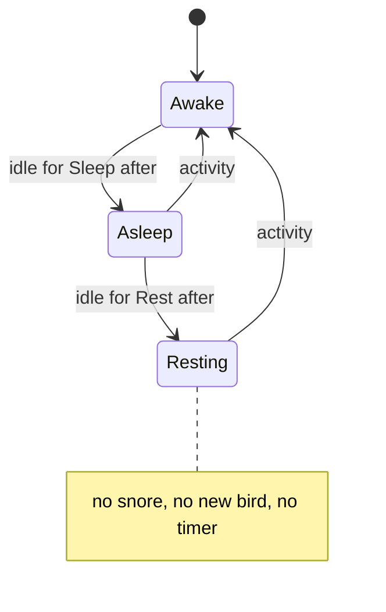
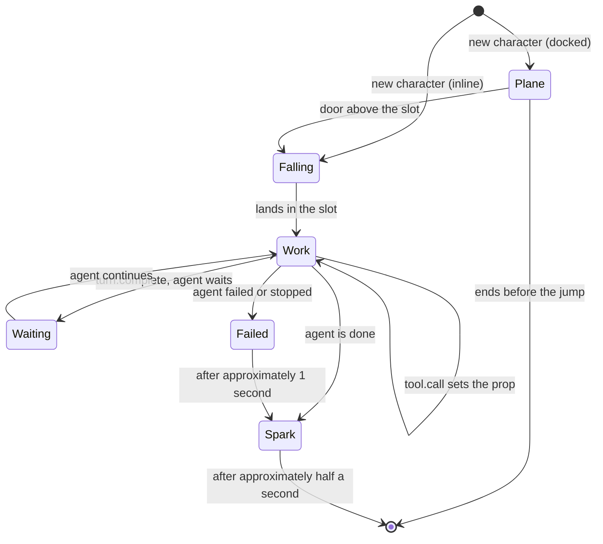

# claudesay

claudesay is a Claude Code mod. It shows an ASCII character in a pane beside the chat.

- While Claude uses a tool, the character holds a prop for that tool.
- After a conversational reply, the character says the main point of the reply in a speech bubble. A small model (Haiku) writes this line.
- Each subagent gets a small character too.

The idea comes from cowsay. claudesay is for fun, and to find out what mods and hooks can do.

After a reply, the pane shows this:

```
 ╭─────────────────────────────────────────────╮
 │ I updated the README and all tests pass. Do │
 │ you want a commit?                          │
 ╰───────┬─────────────────────────────────────╯
         │

      /\__/\
     ( ^ᵕ^  )
   ╭╭: ,,,, :╮╮
   ○ (      ) ○
     (╭....╮)
    (_)    (_)╰~~>
```

While a tool runs, the pane shows the tool and a prop:

```
 ╭────────────────────────╮
 │ Edit → /repo/README.md │
 ╰───────┬────────────────╯
         │

      /\__/\
     ( -.-  )
 🔧○═: ,,,, :╮╮
     (      ) ○
     (╭....╮)
    (_)    (_)╰~~>
```

Each subagent character parachutes into the pane. It stands beside the main character, or below it in a narrow pane. Its task shows as a label. Refer to [Subagents](#subagents). In a wide pane:

```
      /\__/\              /\__/\              /\__/\
     ( ._.  )            ( -.-  )            ( ^▽^  )
   ╭╭: ,,,, :╮╮      🔍○═: ,,,, :╮╮        ╭╭: ,,,, :═○🪄
   ○ (      ) ○          (      ) ○        ○ (      )
     (╭....╮)            (╭....╮)            (╭....╮)
    (_)    (_)╰~~>      (_)    (_)╰~~>      (_)    (_)╰~~>
   Captain             Explore repo        Run the tests
```

claudesay does not add text to the transcript. Refer to [The history stays complete](#the-history-stays-complete).

## Contents

- [Requirements](#requirements)
- [Install](#install)
- [Use](#use)
- [What the character shows](#what-the-character-shows)
- [How it works](#how-it-works)
- [FAQ](#faq)
- [Known limitations](#known-limitations)
- [Character customization](#character-customization)
- [Development](#development)

## Requirements

- Claude Code 2.1.287 or later in the terminal, or 2.1.286 or later in the Desktop app. Mods do not work in earlier versions.
- An interactive session. Use the terminal, the Code tab of the Desktop app, or the VS Code extension (version 2.1.299 or later).

claudesay does not need Bash or `jq`.

## Install

### In a Claude Code session

1. Type this command:

   ```
   /plugin install claudesay --marketplace TimJJTing/claudesay
   ```

2. When Claude Code asks `Add marketplace?`, type `y`.
3. Select a scope. The default is the user scope.

The mod starts immediately. You do not have to restart the session.

### From a shell

Type this command:

```bash
claude plugin install claudesay --marketplace TimJJTing/claudesay
```

### In the Desktop app

The Desktop app does not have `/plugin`. Do these steps:

1. Click **+** adjacent to the prompt box.
2. Click **Plugins**.
3. Click **Add marketplace**.
4. Type `TimJJTing/claudesay`.
5. Click **Add plugin**.

### Upgrade from version 2

Version 3 is a mod. It replaces the Bash hooks of version 2. After the upgrade, do these steps:

1. Remove the old flag file. Version 3 does not use it:

   ```bash
   rm -f .claude/.claudesay-active
   ```

2. If you have `~/.claude/claudesay/character.sh`, write the same values to `~/.claude/claudesay/character.json`. Refer to [CHARACTER_CUSTOMIZATION.md](CHARACTER_CUSTOMIZATION.md#migrate-from-charactersh).
3. To turn the character off, set the mode to `off`. Refer to [Use](#use). Version 3 does not have the old phrases ("turn on claudesay").

Version 2 drew a bubble under each reply. Version 3 shows one character in a pane, with only the newest line.

## Use

claudesay is on after the installation.

### Change the mode

1. Type `/config`.
2. Find the **claudesay** row **Mode**.
3. Select a mode:

| Mode | Result |
| --- | --- |
| `on` | The default. The character holds a prop while a tool runs. After a conversational reply, it says the main point of the reply. Subagents show. |
| `tools` | The same as `on`, but with no bubble after a reply. The mod makes no model calls. |
| `off` | No character and no pane. The mod adds no hooks. |

The mod loads again immediately with the new mode. You do not have to restart the session.

### Change the idle times

The same menu has two rows for the idle times. Each row takes a value from `30s` to `10m`, in steps of 30 seconds. Refer to [Sleep](#sleep).

| Row | Default | Result |
| --- | --- | --- |
| **Sleep after** | `2m` | After this idle time, the character falls asleep. |
| **Rest after** | `5m` | After this idle time, the mod saves power. A value less than **Sleep after** counts as **Sleep after**. |

### The pane

The mod opens its pane at the start of each session. Claude Code puts the pane in one of two places:

| Layout | Where the pane shows |
| --- | --- |
| Fullscreen, 110 columns or more | Docked beside the transcript. The drawing is at the bottom of the pane, next to the prompt. |
| Main screen (`CLAUDE_CODE_NO_FLICKER=0`, tmux by default), or fullscreen with less than 110 columns | Inline above the prompt. |

- **Open the pane.** Claude Code shows the pane by itself only on a terminal of 144 columns or more. On a narrower terminal, type `/claudesay`. This opens the pane at any width. After you open it one time with `/claudesay`, later sessions show it from 110 columns. If Claude Code cannot show the pane yet, `/claudesay` tells you why.
- **When the pane opens.** The character parachutes in. Its bubble shows after it lands. In the `on` mode, with no line to say yet, it says: "Hi! I'll sum up each reply here." The next turn clears this greeting.
- **Close the pane.** Click its close mark, or press ctrl+x x. Later sessions do not open it. A toast tells you to type `/claudesay` to open it again. While the pane is closed, the mod makes no model calls.
- **Size.** The drawing follows the size of the pane. A wide pane puts the subagents beside the main character. A narrow pane puts them below it. The bubble text wraps at 45 columns, or less in a narrow pane. If the line is too long for the pane, the bubble ends in "…". The reply always has the full information. To make the docked pane narrower, drag its edge. For a smaller drawing, use a smaller character in `character.json`.
- **Height.** The inline pane does not get shorter until the next turn starts. Thus, the prompt does not move when a bubble comes and goes.
- **Other panes.** When another mod also opens a pane, Claude Code shows the panes as tabs. To change the pane that shows, click a tab or press ctrl+x tab.

## What the character shows

The main character shows one of these items. The mod shows the first item that applies:

1. The sleeping face `( ɛ_ɛ  )`, when the session is idle. Refer to [Sleep](#sleep).
2. The newest tool that runs now, with its prop. When tools run in parallel, it shows only the newest one. Subagent characters do the same.
3. A thinking face, while Claude works and no tool runs. The thinking face also shows until the line about the reply comes.
4. The line about the last reply.
5. A happy face.

### Sleep

If nothing occurs for the **Sleep after** time (two minutes by default), the character falls asleep. It shows the sleeping face `( ɛ_ɛ  )`.

The session is idle when one of these conditions is true:

- No turn runs and no subagent works.
- The main loop waits on you: a question (`AskUserQuestion`), a plan to approve (`ExitPlanMode`) or a permission dialog.

The idle time starts at the end of the turn, or when Claude starts to wait on you.

- **The bubble.** When the character sleeps, it keeps its bubble: the line about the last reply, or the label of the tool that waits on you. If the bubble has nothing to say, it snores: `z`, `z Z`, `z Z z…`, one frame each second.
- **Wake up.** These actions wake the character: a new turn, a key in the prompt box, and your answer to a question or a plan. Then the idle time starts again. After a permission dialog, the character wakes only when the tool finishes. Refer to [Known limitations](#known-limitations).
- **Save power.** After the **Rest after** time (five minutes by default), the snore stops on `z Z z…` and no new bird comes. A bird in the air flies out of the pane. Then the mod runs no timer until the character wakes.

### Birds

Sometimes a bird flies across the docked pane. It looks like `\v/` (wings up) and `-v-` (wings level).

- It starts from the left or the right edge, in an empty row at a random height. It stays in that row.
- It flies behind everything. A character, a label, the bubble or the plane covers it. It never shows inside the bubble.
- A new bird comes 15 to 60 seconds after the last one. Birds come while the character is awake or asleep, until the mod saves power.
- The inline pane has no birds.

### Subagents

The main loop is Claude's own conversation. Each subagent that the main loop starts gets a character.

- **Start.** The character goes to the next free slot. The slots fill in reading order: first the row of the main character, then the rows below. The oldest subagent is nearest to the main character. The label shows in the slot immediately. The character floats down to the slot under a canopy.
  - In the docked pane, a plane flies from left to right along the top of the pane. The character jumps when the door of the plane is above its slot.
  - In the inline pane, there is no plane. The character starts just above the top of the pane.
  - While subagents show, the label of the main character is `Captain`.
- **Subagents that already run.** When the pane opens, these subagents come down into the pane with the main character. A character that leaves or that failed stays in its slot. A subagent that started while the mod was off comes in at the next turn.
- **Work.** The character holds the prop of the tool that its subagent runs now. It uses the same props as the main character. Between tools, it shows a thinking face. While it floats down or moves to another slot, it looks happy. Its label is the `description` of the Agent call, or the agent type if the call has no description. The mod cuts a long label to the slot width.
- **Wait.** A subagent can start background work, for example a long command, and stop until the work is done. Its character stays in its slot during the wait. When the subagent continues, the character does not float down again.
- **Finish.** The character changes into a spark ✦. The spark shows for approximately half a second. Then the character and its label go away. The characters after it move into the free slot. A character that is still in the plane goes away immediately.
- **Failure.** A run can stop, get a refusal or end with an error. Then the character shows the error face for approximately one second, and leaves. During this time, the main character looks upset, unless it holds a prop or says a line.
- **Too many.** The pane keeps 10 rows for the bubble. Thus, the subagents do not move when a bubble comes or goes. The height that remains holds rows of slots. When all slots are full, the last slot shows `+3 more`. The next subagent comes in when a slot is free. When the pane has space for the main character only, it shows `🤖×3` beside it.
- **Resize.** When the pane gets wider or narrower, the slots move. A character slides to its new column, behind the main character. A character that moves to a different row jumps to it.

This is the docked pane while a subagent drops in:

```
                             |\______________
                             |_[]_°_°_°_°_°__)-=

                         _.-""""-._
                        .'        '.
                        (__________)
                         \        /
                          /\__/\
                         ( ᵕ‿ᵕ  )
                       ╭╭: ,,,, :╮╮
      /\__/\           ○ (      ) ○
     ( ._.  )            (╭....╮)
   ╭╭: ,,,, :╮╮         (_)    (_)╰~~>
   ○ (      ) ○
     (╭....╮)
    (_)    (_)╰~~>
   Captain             Explore repo
```

Only the main character has a speech bubble. Nested subagents, workflow agents and teammates do not show. Refer to [Known limitations](#known-limitations).

If the mod does not see the end of a subagent's run, the character leaves at the next turn.

### The line

After each final answer of the main loop, the mod sends the answer to Haiku with `$.model.complete`. Haiku gives back a mood and one line, or `NONE`.

- The line gives the main point of the reply.
- The line speaks as Claude to you ("I", "you", "we").
- If the reply asks a question, the line ends with that question.
- For a reply that is mostly code, a diff or long technical output, Haiku gives `NONE`. Then the pane shows no bubble.

The moods are `happy`, `excited`, `thinking`, `focused`, `upset` and `error`.

Haiku reads only the answer, and at most its last 8000 characters. It does not read the conversation, the tools or the system prompt. The answer goes between `<reply>` tags. The prompt tells Haiku that the answer is data, not instructions.

The thinking face shows until the line comes. A new turn stops the call, so a late line never shows. If the call fails or takes more than 20 seconds, there is no bubble.

The mod does not ask for a line in these conditions:

- The mode is `tools`.
- The run of a subagent ended.
- You interrupted the reply, or the reply ended with a refusal or an error.
- The session has no screen.
- You closed the pane.

### The history stays complete

The bubble shows only the newest line. Thus, the reply must have all of the information. The line comes from the reply. The mod does not change the reply or the stored messages.

The mod checks each line before the pane shows it. The pane does not show the line in these conditions:

- The line has a link, a domain name, a path, a code span or a command word (for example `curl` or `sudo`). The reply does not have it as a whole word.
- The line asks for consent, for example `[y/N]` or "type y". The reply does not ask for it.
- The line has more than 300 characters.

The bubble never asks for permission. Claude Code shows all permission prompts itself.

The check works for all scripts:

- Before the comparison, the mod changes fullwidth letters, digits and dots to plain ones. It removes invisible characters.
- It changes an ideographic dot (`。`) to `.`, but not next to Chinese, Japanese or Korean text, or before a capital letter. There, the dot ends a sentence. Thus, `完成了。中文` and `vitest。Tests` are not domain names, but `evil。com` is.
- It compares whole tokens. Thus, `rm` does not match "format", and `evil.com` does not match "evil.com.example.org".

The mod also checks the tool label in the bubble. A path that looks like a consent prompt shows as the tool name only. A path of more than 50 characters ends in "…".

Before the mod draws text, it removes control characters and format characters, for example terminal escape sequences and bidirectional overrides. It also removes characters that draw as nothing, for example variation selectors and Hangul fillers, because they can hide text. It keeps the characters that emoji need.

The check compares words, not meaning:

- A line can say "All tests pass" when the reply says that the tests are not done.
- The check does not examine numbers.
- A reply can quote instructions, for example from a web page. Haiku can obey them in the line.
- Some domain names with `。` next to Chinese, Japanese or Korean text pass, for example `例子。com`.

Do not act on the bubble alone. Read the reply.

## How it works

claudesay is one TypeScript module, `hooks/claudesay.tsx`. Claude Code loads it as a mod. The event hooks do not draw. They write to the plugin state. The timers and the Haiku reply also write to the state. When the state changes, Claude Code calls the `ui.render` hook. This hook reads the state and draws the pane.



All hooks only observe. They do not change, block or approve a prompt, a tool call, a spawn or a permission request.

### One turn

This diagram shows the hooks during one turn of the main loop.



### The hooks

| Event | What the hook does |
| --- | --- |
| `session.start` | Registers the `/claudesay` command. Reads `character.json`. Resets the state. Opens the pane, unless you closed it. In the `on` mode, sets the greeting. Starts the idle time. |
| `turn.start` | Wakes the character. Clears the last line, and stops a call for a line that has not come. Lets the inline pane get shorter again. Reads `character.json` again. Makes the subagent characters agree with the agents that run (`syncCrew`). |
| `command.run` `claudesay` | Opens the pane at any width. |
| `ui.close` | Remembers that you closed the pane, so that later sessions do not open it. Shows a toast that names `/claudesay`. |
| `agent.spawn` | Adds a character for each subagent that the main loop starts. A resumed subagent keeps its character. |
| `tool.call` | Adds each tool of the main loop to `running` before it runs, and removes it when it stops. For a subagent, sets the prop of its character. A question or a plan to approve counts as idle time. |
| `prompt.edit`, `prompt.change` | Wakes the character when you type in the prompt box or recall a history entry. |
| `classic.PermissionRequest` | Marks the tool call that a permission dialog asks about, so that the wait counts as idle time. |
| `turn.complete` | For the main loop, clears `running`. In the `on` mode, it sends a final answer that is not empty to Haiku. The hook does not wait for the line. For a subagent, sends its character off, unless `$.agent.list()` shows the agent as `waiting`. |
| `ui.render` `Pane` | Draws the character, the subagents, the bubble and, when docked, the bird. |

### The hook state

The state contract is in `types/index.d.ts`. Each key is an atom in `hooks/claudesay.tsx`.

| Key | What it holds | Written by |
| --- | --- | --- |
| `running` | The tool calls of the main loop that run now. `waits` marks a call that waits on you. | `tool.call`, `classic.PermissionRequest`, `turn.complete` |
| `working` | True while a turn runs, and until its line comes. | `turn.start`, `turn.complete`, the Haiku reply |
| `saying` | The mood and the line about the last reply, or the greeting. | `session.start` and `command.run` (the greeting), `turn.start`, `turn.complete`, the Haiku reply |
| `crew` | The subagent characters: slot position, label, prop and phase. | `agent.spawn`, `tool.call`, `turn.complete`, `syncCrew`, the animation timer |
| `sleep` | The snore while the character sleeps, or null. | The idle timer, the snore timer, and each hook that wakes the character |
| `landing` | The drop of the main character into a pane that just opened. | The animation timer |
| `bird` | The bird that flies now, or null. | The bird timer, the animation timer |
| `character` | The override from `character.json`. | `session.start`, `turn.start` |

`session.start` resets all keys except `landing`. `ui.render` reads all of the keys. Some values are not in the state, because a change to them does not need a new draw. For example, the tallest height of the turn (`tallest`) and the timers are module variables.

### Sleep and rest



Activity is a new turn, a key in the prompt box, your answer, a new line, the end of a subagent, or a dialog that starts. Activity starts the idle time again.

The idle time uses one `$.clock.after` timer at a time. The mod sets it at the start of the session and when the work ends. The snore uses a `$.clock.every` timer of one second, only while the bubble snores.

### A subagent character



A new character comes from `agent.spawn` or from `syncCrew`. The end of an agent comes from `turn.complete` or from `syncCrew`.

The characters move on a `$.clock.every` timer. This timer runs only while a character moves or a bird flies. If Claude Code stops the timer, the next draw of the pane starts it again. The next bird waits on a `$.clock.after` timer of 15 to 60 seconds (`BIRD_MIN`, `BIRD_MAX`). Only a docked draw sets this timer.

When the pane opens and at each `turn.start`, the mod asks Claude Code which agents run (`syncCrew`). A subagent of the main loop that runs but has no character gets one. A forked skill of the main loop has no `agent.spawn`, so it comes in this way. A character whose agent stopped leaves. It shows the error face only if the agent failed or was killed.

## FAQ

### Does claudesay use tokens?

In the `on` mode, yes, but not many, and not from the main model. After each final answer, the mod makes one call to Haiku through your session's own API client. The call sends a short system prompt and the answer, and gets back one line. The mod adds nothing to the system prompt or to the messages of the session. Thus, the main model uses no tokens for the bubble.

In the `tools` mode and in the `off` mode, claudesay uses no tokens.

### Does claudesay send data on the network?

Only in the `on` mode. The call to Haiku sends the final answer to the API, through the same client, credentials and provider as your session. The mod sends nothing to other places. All drawing occurs in the mod.

### Does the transcript or the context change?

No. The mod adds no text to the replies, and the stored messages do not change. Claude does not see the art or the line. The pane shows only the newest line. To read an earlier reply, scroll back to it.

### Why is there no bubble after a reply?

Possible causes:

- **The reply is not conversational.** Haiku gives `NONE` for code, diffs and long technical output.
- **The line said more than the reply.** Then the pane does not show it. Refer to [The history stays complete](#the-history-stays-complete).
- **The call failed.** For example, your provider does not allow Haiku, the API returned an error, or the call took more than 20 seconds.
- **You interrupted the reply, or it ended with an error.** Such a reply gives no line.
- **The mode is `tools` or `off`.** Type `/config` and examine the claudesay mode.
- **A new turn started.** A new turn clears the line.
- **There is no pane.** The terminal is too narrow for the pane, or you closed it. Type `/claudesay`. Refer to [The pane](#the-pane). A closed pane, `--print` mode and an SDK host give no call, because nothing draws the line.
- **Another pane shows.** Another mod's pane is in front. Click the claudesay tab.

### How is claudesay different from Buddy?

Buddy was a virtual pet in earlier versions of Claude Code. You hatched it and you cared for it. claudesay is different:

- **Automatic.** The character shows when Claude works. You do not call it.
- **No state between replies.** There is no creature that grows. Each line is about one reply. The next turn replaces it.
- **A mod.** Anyone can install it. It does not need a built-in Claude Code feature.
- **About the work.** The character shows what Claude does now.

## Known limitations

These limits come from what a mod and its hooks can see and do today, or from choices in the mod.

- **The character sleeps through an approved tool.** No hook event tells the mod that you answered a permission dialog. `tool.call` hears only the start and the end of the call. If you approve a long command after the idle time, the character sleeps until the command finishes.
- **The pane does not open by itself on a narrow terminal.** Claude Code shows the pane by itself only from 144 columns. After you open it one time, the limit is 110 columns. Type `/claudesay` to open it at any width.
- **Some agents do not show.** `$.agent.list()` does not list workflow agents. A teammate stops between its turns, so no hook tells the mod when it is done. The mod also leaves out nested subagents, to keep the pane easy to read.
- **One layout for all screens.** The mod keeps one state for each session, not for each screen. When two screens of different sizes draw the pane at the same time, the subagent characters can jump between the two layouts. For example, this occurs when the Desktop app connects to a session in your terminal.
- **The emoji width is a guess.** A mod cannot ask the terminal how wide it draws an emoji. The mod counts two columns. If your font uses one column, use single-width props. Refer to [CHARACTER_CUSTOMIZATION.md](CHARACTER_CUSTOMIZATION.md#single-width-props).
- **Each line costs one model call.** `$.model.complete` uses your session's provider. A provider that does not allow Haiku gives no bubble. To use a different model, change `SAY_MODEL` in `hooks/claudesay.tsx`.

## Character customization

Refer to [CHARACTER_CUSTOMIZATION.md](CHARACTER_CUSTOMIZATION.md). It gives the grid layout, the faces, the cells, the prop templates and the tool props.

## Development

### Project structure

```
claudesay/
├── .github/workflows/
│   └── test.yml              # CI: claude plugin validate and claude plugin test.
├── .claude-plugin/
│   ├── plugin.json           # Plugin manifest. Names the state contract, the mode and the idle times.
│   ├── marketplace.json      # Makes this repository a marketplace.
│   ├── icon.png              # Plugin icon: the default character, 1024 × 1024.
│   └── types/                # Claude Code writes this folder. Git ignores it.
├── hooks/
│   ├── hooks.json            # Names the hooks module.
│   ├── claudesay.tsx         # The hooks module: events, state, the call for the line, the command and the pane.
│   ├── art.ts                # Pure functions: character, bubble, the line prompt and parse, line check, tool props.
│   ├── crew.ts               # Pure functions: the slots, the plane, the parachute, the spark and the crew drawing.
│   └── sky.ts                # Pure functions: the bird that flies across the docked pane.
├── types/
│   └── index.d.ts            # State contract and shared types.
├── tests/
│   ├── art.test.ts           # Unit tests for art.ts.
│   ├── crew.test.ts          # Unit tests for crew.ts.
│   ├── sky.test.ts           # Unit tests for sky.ts.
│   └── claudesay.test.tsx    # Tests for the hooks against the Claude Code engine.
├── tsconfig.json             # Type-check configuration.
├── LICENSE
├── README.md
└── CHARACTER_CUSTOMIZATION.md
```

### Load the mod from your checkout

1. If you installed the marketplace version, uninstall it:

   ```bash
   claude plugin uninstall claudesay
   ```

2. Start a session that loads the mod from the folder:

   ```bash
   claude --plugin-dir .
   ```

Claude Code watches the folder. When you save a file, the mod loads again. You do not have to restart the session. To see hook errors, add `--debug`.

### Check the mod

Before you push a change, do these checks:

```bash
claude plugin validate .
claude plugin test .
npx -p typescript@5.6.3 tsc -p .
```

- `claude plugin validate` reads the manifest and the module. It shows the hooks, the calls and the state keys.
- `claude plugin test` runs the `*.test.ts` and `*.test.tsx` files against the Claude Code engine.
- `tsc` checks the types. It needs the types that Claude Code writes to `.claude-plugin/types/`. Thus, load the mod one time before you run `tsc`.

## License

MIT
